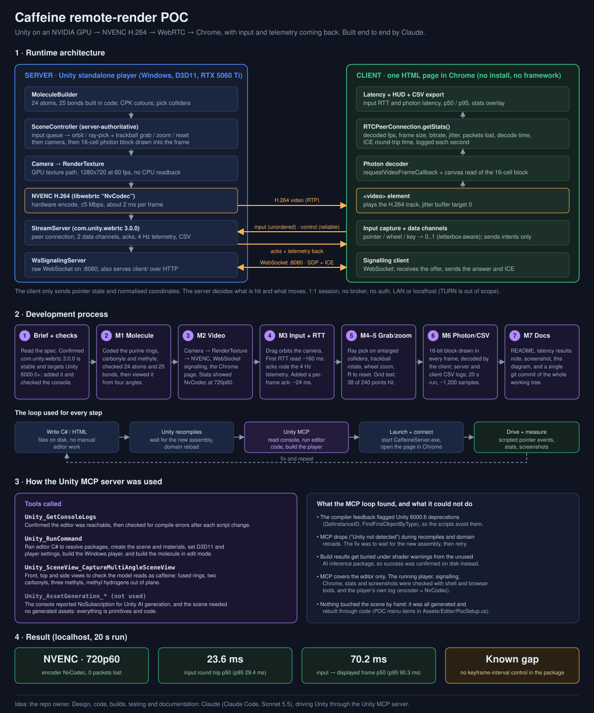

# Caffeine molecule – remote-rendered WebRTC proof of concept

A Unity standalone player renders a ball-and-stick caffeine molecule on an NVIDIA GPU,
hardware-encodes it (H.264 via NVENC) and streams it over WebRTC to a plain HTML page in
Chrome. The page sends pointer/wheel/keyboard *intents* back over a data channel; the
server decides what they do. 1:1, no broker, no auth, no TURN. This is a POC, not a product.


*The stream as seen in Chrome. Top-left is the stats overlay (NVENC H.264, 1280x720 at 60 fps). The black/white
cells at the bottom-left of the frame are the photon-latency block, which encodes the last applied input number.*

**Status:** working proof of concept, tested on localhost only (Windows, NVIDIA GPU, Chrome).
Measured on localhost: input round trip p50 23.6 ms, input-to-displayed-frame p50 70.2 ms
(see [docs/latency-results.md](docs/latency-results.md)).



*Architecture, how it was built, and how the Unity MCP server was used. Idea supplied by the repo owner; design, code, builds, testing and docs by Claude.*

```
Chrome (client/index.html) <--- WebSocket :8080 (SDP + ICE only) ---> Unity player
                           <=== WebRTC H.264 video (NVENC) ==========  (SceneController)
                           ===> data channels "input" / "control" ===>
                           <=== telemetry + per-frame acks ==========
```

## Layout

| Path | What |
|---|---|
| `Assets/Scripts` | `MoleculeBuilder` (model in code), `SceneController` (input, camera, grab, photon block), `StreamServer` (WebRTC, telemetry, CSV), `WsSignalingServer` (WebSocket + static file server) |
| `Assets/Editor/PocSetup.cs` | `POC` menu: creates the scene/materials, sets player settings, builds the player |
| `client/` | `index.html`, `client.js`, `styles.css` (no framework, no install) |
| `build/` | Player build output (`CaffeineServer.exe`), git-ignored |
| `logs/telemetry/` | CSVs written by the server (client CSVs are downloaded from the page) |
| `docs/` | Notes and latency results |

The Unity project lives at the repo root (not in a `/server` subfolder). Note that on Windows
`logs/` is the same folder Unity uses for its own `Logs`; telemetry goes in `logs/telemetry/`.

## Requirements

- Windows 10/11 x64 with an NVIDIA GPU and current driver (tested: RTX 5060 Ti, driver 32.0.16.1088).
- Unity **6000.6.7f1** (the version in `ProjectSettings/ProjectVersion.txt`), Windows Build Support.
- `com.unity.webrtc` **3.0.0** (already in `Packages/manifest.json`; declares Unity 6000.0+).
- Google Chrome on the client.

## Build the server

1. Open the project in Unity.
2. Menu **POC → Create Caffeine Scene** (creates `Assets/Scenes/Caffeine.unity`, CPK materials,
   and sets Direct3D11 as the only graphics API, which the NVENC texture path needs).
3. Menu **POC → Build Windows Server** → `build/CaffeineServer.exe`.

Builds print many shader warnings from the unused `com.unity.ai.inference` package. They are harmless.

## Run

```powershell
.\build\CaffeineServer.exe -logFile logs\player.log
```

Optional arguments: `-width 1280 -height 720 -fps 60 -bitrate 5000` (kbps) `-port 8080`
`-stun stun:stun.l.google.com:19302` (default: host candidates only, which is right for LAN/localhost).

Open Chrome at **http://localhost:8080/** (or `http://<server-ip>:8080/` from another machine on the
LAN; allow the port through the Windows firewall, and UDP for WebRTC). The page is served by the
player itself. A newer connection replaces an older one.

The player window shows a local preview. Closing the window stops the server.

## Controls (in the video)

| Input | Effect |
|---|---|
| Drag on empty space | Orbit the camera around the molecule's centre |
| Press on an atom, drag | Grab and rotate the molecule (trackball); camera does not move |
| Release | Release the molecule (no inertia) |
| Wheel | Zoom (distance clamped 4–30) |
| `R` | Reset camera and molecule |

The cursor shows `grabbing` while the server reports a grab. Picking uses sphere colliders 1.6× the
visible atom radius.

## What gets measured

On-page HUD, updated each second, plus CSVs:

- **Input RTT** – client send time → server's per-frame ack (`lastAppliedSeq` ≥ seq). Client clock only.
- **Photon latency** – the server draws 16 black/white cells (bottom-left, 12 px each) encoding
  `lastAppliedSeq` into every frame. The client reads them from the decoded video with
  `requestVideoFrameCallback` + canvas, and measures send → displayed. This includes render, encode,
  network, jitter buffer and decode.
- **From `getStats()`** – frame size, decoded fps, bitrate, jitter, packets lost, decode time, ICE RTT.
- **Server** – frame time, encode time/fps and encoder implementation (`NvCodec` = NVENC), from the sender stats.

CSV files:
- `logs/telemetry/server_<timestamp>.csv` – written by the server at 4 Hz.
- **Download CSV** button on the page → `client_stats_*.csv` (1 Hz), `client_rtt_*.csv` (per input),
  `client_photon_*.csv` (per input). A page cannot write into the repo, so these land in your Downloads folder.

## Decisions and known limits

- **GPU texture path** is used (camera → RenderTexture → NVENC). No CPU readback fallback was needed.
- **Server is the WebRTC offerer**; the client answers. Two data channels: `input` (unordered,
  `maxRetransmits: 0`; move and wheel) and `control` (reliable; down, up, key, and telemetry).
- **RTT uses a per-frame ack on the unreliable channel**, not the 4 Hz telemetry message, because the
  telemetry cadence would otherwise dominate the number (it measured about 160 ms before this change).
- **Keyframes:** `com.unity.webrtc` 3.0.0 exposes no keyframe interval or keyframe request, and the
  encoder produced a single keyframe per session in testing. Chrome requests a new one on packet loss, so
  LAN use is fine, but the "keyframe every 1–2 s" goal is **not met**.
- **Headless:** not tested. Unity cannot render with `-nographics`; a GPU server with no monitor needs a
  virtual display (or a dummy HDMI plug).
- **Internet use needs TURN**, which is out of scope. STUN alone only works for some NATs.
- Chrome only. Only one session at a time.
